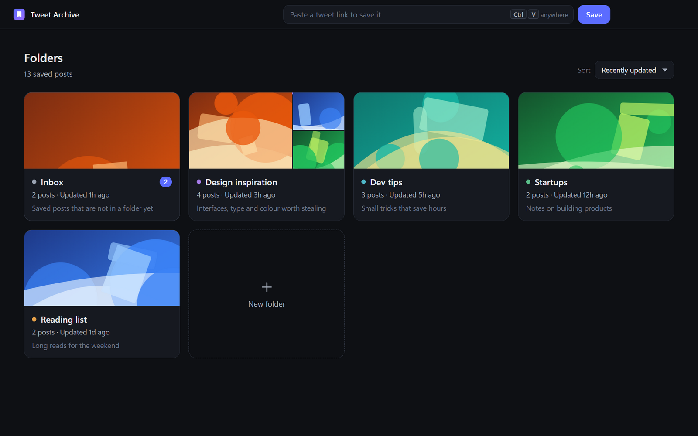
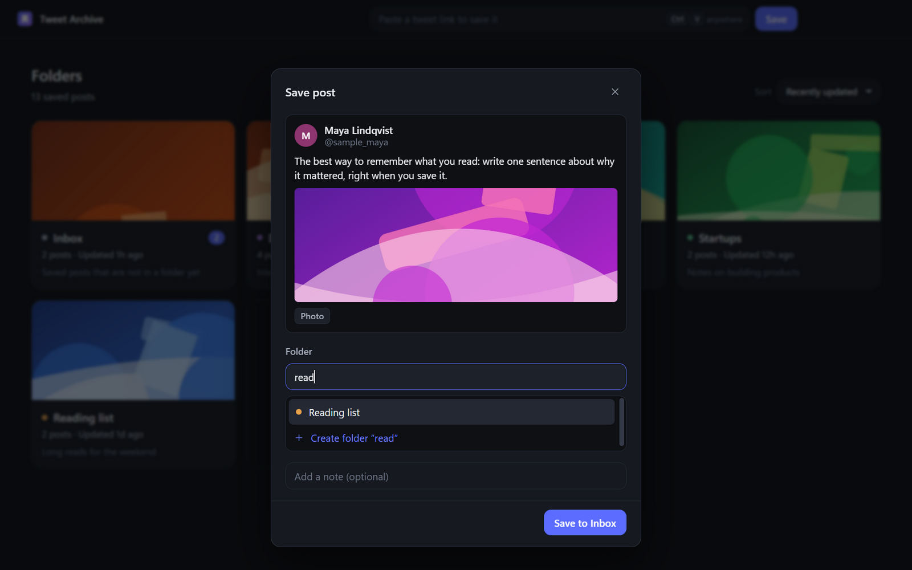
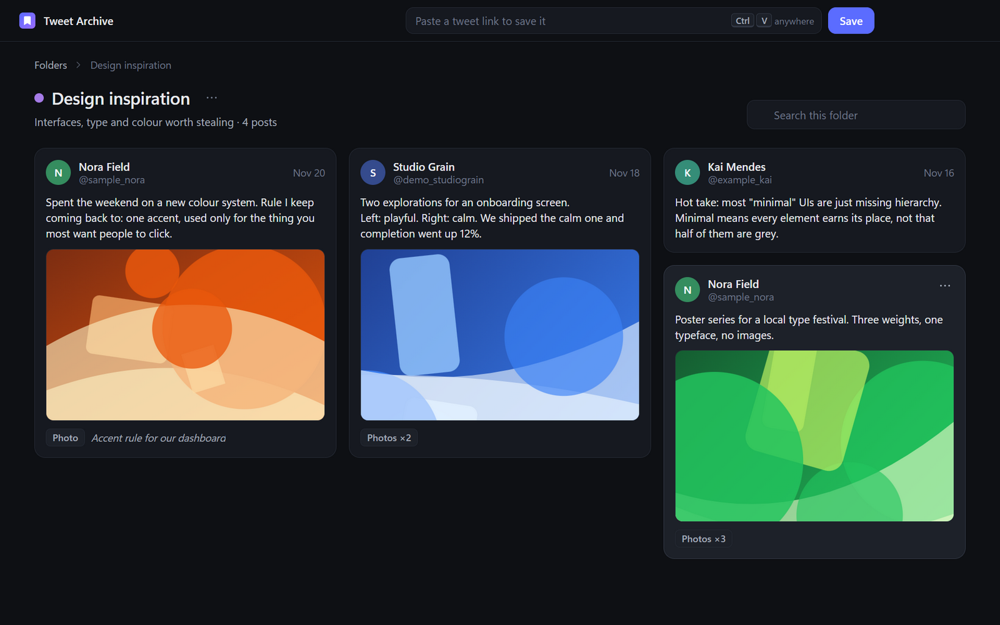
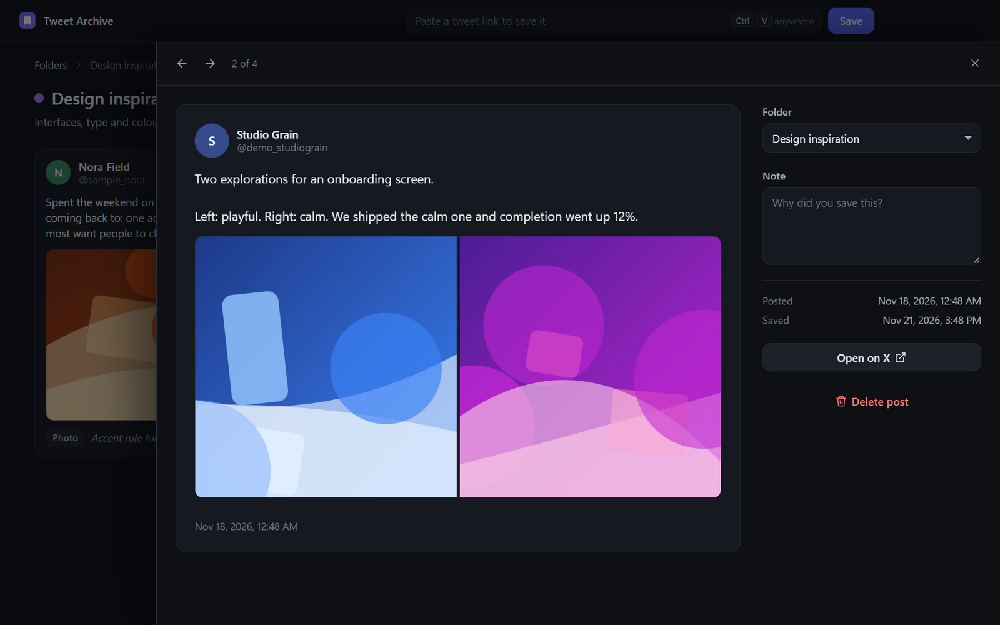
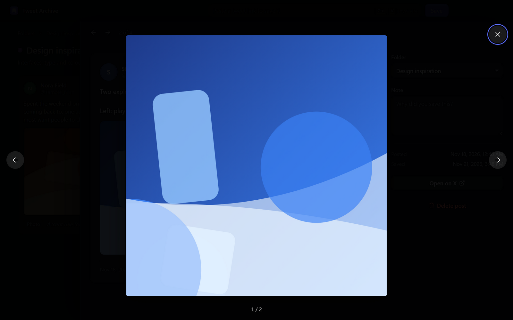
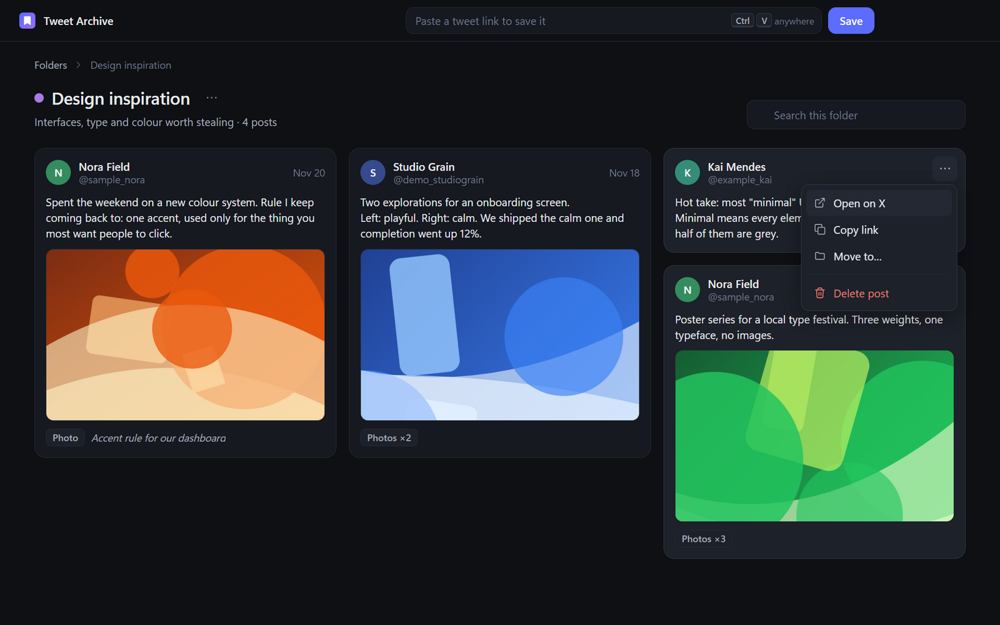
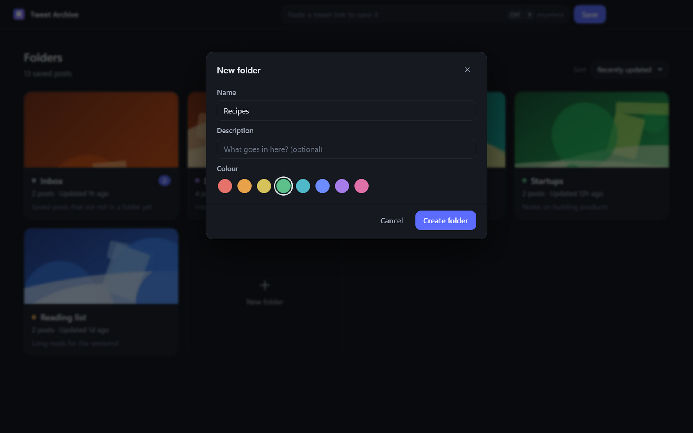

<div align="center">


# Tweet Archive

**Save posts from X (Twitter) to your computer and sort them into folders.**

Paste a link and the app keeps a local copy of the post's text, photos, videos and a screenshot.<br />
Your saved posts stay readable even if the original is edited or deleted.

</div>

<p align="center">
  
</p>

> All accounts, posts and images in these screenshots are made-up demo data.

---

## Demo

<p align="center">
  
</p>

What the walkthrough shows:

1. Paste a link. A dialog opens with a preview of the post.
2. Type a few letters to find a folder, then press **Enter** to save the post there.
3. Open the folder. Click a post to read it in a side panel.
4. Use **←** / **→** to move between posts. Click a photo to view it full screen.

---

## Features

### Saving
- **Paste a link, or press Ctrl+V anywhere in the app.** Works with `x.com`, `twitter.com` and mobile links.
- **Pick a folder while the post downloads.** Folders you used recently are listed first. Type a new name to create a folder in the same box.
- **Already saved?** Pasting a saved link shows which folder it's in, so you can move it from there.
- **A full local copy:** text, photos, videos, GIFs and quoted posts, plus a screenshot of the post as it looked on X.
- **Clear errors.** Deleted, private and mistyped links each get a plain explanation and a **Try again** button.

### Organising
- **Folders as cards**, with a cover made from recent images, a post count and when each folder was last updated.
- **Inbox** collects posts you haven't sorted yet. Its counter shows how many are waiting.
- **Rename, recolour, describe or delete** a folder from its **⋯** menu. Deleting a folder moves its posts back to Inbox and never deletes them.
- **Sort folders** by recently updated, name or number of posts.
- **Notes:** add a line about why you saved something. Notes save themselves as you type.

### Reading
- **Post grid** for each folder, with a search box that also searches your notes.
- **Side panel** for reading a post, with photos, playable videos, looping GIFs and quoted posts.
- **← / →** step through the posts in a folder without leaving the panel.
- **Full-screen photo viewer** with arrow-key navigation.
- **Open on X** and **Copy link** whenever you need the original.

### Safe to use
- **Undo** after deleting a post or folder, or after moving a post with **Move to…**. Nothing asks "are you sure?", and nothing is lost by mistake.
- **Everything stays on your computer.** No account, no sign-in, no cloud.

---

## Screenshots

| | |
|---|---|
|  |  |
| **Save dialog.** Preview the post, then pick or create a folder. | **Folder view.** All posts in a folder, searchable. |
|  |  |
| **Post panel.** Read the full post, change its folder, add a note. | **Photo viewer.** Full-screen photos, ← / → between them. |
|  |  |
| **Post menu.** Open, copy, move or delete. | **New folder.** Name, optional description and a colour. |

---

## Install (Windows)

1. Open the [**Releases page**](https://github.com/mainak9163/twitter-bookmark/releases/latest) and download **`Tweet-Archive-Setup-<version>.exe`**.
2. Double-click the file you downloaded.
3. Windows may show **"Windows protected your PC"**. Click **More info**, then **Run anyway**.<br />
   <sub>This happens because the installer isn't signed with a paid code-signing certificate yet. The app is the same either way.</sub>
4. Click **Next**, choose where to install it (or keep the default), then click **Install**.

Tweet Archive is added to the **Start menu** and your **desktop**. Installing doesn't need administrator rights.

### Updates

Updates install themselves. The app checks for new versions in the background. When one has downloaded, it shows **"Restart to update"**. If you ignore the message, the update installs the next time you close the app.

### Uninstall

Go to **Settings → Apps → Installed apps → Tweet Archive → Uninstall**.<br />
Your saved posts are **kept**. They live in a separate folder (see [Where your data is stored](#where-your-data-is-stored)), so reinstalling brings them all back.

### macOS and Linux

There are no installers for macOS or Linux yet. Run the app from source instead (see below).

---

## Run from source

For developers, and for macOS and Linux.

1. Install **[Node.js](https://nodejs.org/) 22 or newer** (LTS; the app is developed on Node 24) and **[Git](https://git-scm.com/downloads)**.
2. Download and start the app:

   ```bash
   git clone https://github.com/mainak9163/twitter-bookmark.git
   cd twitter-bookmark
   npm install
   npm start
   ```

   `npm install` downloads Electron (about 100 MB) the first time. `npm start` compiles the app and opens it.

To update, run `git pull`, then `npm install` and `npm start`.

---

## How to use

| To… | Do this |
|---|---|
| Save a post | On X, choose **Share → Copy link**. Then press **Ctrl+V** anywhere in the app (**⌘V** on macOS), or paste into the top bar and press **Enter**. |
| Put it in a folder | In the save dialog, type part of a folder's name and press **Enter**, then **Enter** again to save. |
| Create a folder | Type a new name in the save dialog, or click **+ New folder** on the home screen. |
| Leave it for later | Press **Esc** or click **Keep in Inbox**. The post is still saved. |
| Read a post | Open a folder and click a post. |
| Move a post | Change **Folder** in the post panel, or use **⋯ → Move to…** on its card. |
| Delete a post | Click **Delete post** in the panel, press **Delete**, or use **⋯ → Delete post**. Click **Undo** to bring it back. |
| Edit a folder | Hover over its card and click **⋯**. |

### Keyboard shortcuts

| Key | Where | Action |
|---|---|---|
| <kbd>Ctrl</kbd> + <kbd>V</kbd> | Anywhere (outside a text field) | Save the tweet link on your clipboard |
| <kbd>Enter</kbd> | Save dialog | Choose the highlighted folder, then save |
| <kbd>↑</kbd> <kbd>↓</kbd> | Save dialog, folder picker | Move through the folder list |
| <kbd>←</kbd> <kbd>→</kbd> | Post panel, photo viewer | Previous or next post (or photo) |
| <kbd>Delete</kbd> | Post panel | Delete the post (with Undo) |
| <kbd>Esc</kbd> | Everywhere | Close the top layer: photo viewer, then panel, then folder |

---

## Where your data is stored

Everything is stored as plain files in your user data folder:

| System | Location |
|---|---|
| Windows | `%APPDATA%\twitter-bookmark\archive` |
| macOS | `~/Library/Application Support/twitter-bookmark/archive` |
| Linux | `~/.config/twitter-bookmark/archive` |

```
archive/
├── folders.json              your folders (name, description, colour)
└── posts/
    └── <post id>/
        ├── post.json         text, author, dates, quoted post
        ├── meta.json         folder and note
        ├── screenshot.png    how the post looked on X
        └── media/            photos, videos and GIFs
```

To back up your archive, copy this folder. To move to a new computer, copy it to the same location there.

### Privacy

The app needs no X account and never asks you to sign in. Saving a post makes three kinds of request:

- the post's data, from the public [FxTwitter](https://github.com/FixTweet/FxTwitter) API
- the photos and videos, from X's media servers
- the screenshot, from X's public embed page, loaded in a hidden window that is always signed out

Nothing else leaves your computer.

---

## Tech stack

| Part | Built with |
|---|---|
| Desktop shell | [Electron](https://www.electronjs.org/) 45, with a hidden title bar and native window controls drawn over the app's own top bar |
| Installer and updates | [electron-builder](https://www.electron.build/) (NSIS installer) and [electron-updater](https://www.electron.build/auto-update), using GitHub Releases |
| Language | [TypeScript](https://www.typescriptlang.org/), compiled with `tsc` (no bundler) |
| Interface | Plain DOM and CSS, no framework. Hash-based routing, native `<dialog>` for modals, and one set of SVG icons. |
| Styling | Hand-written CSS with design tokens (custom properties), a dark theme and reduced-motion support |
| Storage | JSON files and media on disk, via Node's `fs` module. No database. |
| Post data | [FxTwitter API](https://github.com/FixTweet/FxTwitter) |
| Screenshots | An offscreen Electron window that captures X's embed page |
| Security | Context isolation, with a small preload API. External links always open in your browser, never inside the app. |

### Project structure

```
src/
├── main.ts         window, app lifecycle, IPC handlers
├── preload.ts      the API the interface is allowed to call
├── renderer.ts     the interface: screens, dialogs, panel, keyboard
├── storage.ts      folders, posts, notes, trash, all on disk
├── fetcher.ts      fetches post data from the FxTwitter API
├── media.ts        downloads photos and videos
├── screenshot.ts   captures the post's embed page
├── parseLink.ts    recognises x.com / twitter.com links
└── global.d.ts     types shared by the interface and the API
public/
├── index.html, styles.css
└── icon.svg, icon.png
```

### Development

```bash
npm run build   # compile TypeScript into dist/
npm start       # build and launch the app
npm test        # build and run the link-parser and fetcher tests
npm run dist    # build the Windows installer into release/
```

### Releasing a new version

Releases are built and published by GitHub Actions ([`.github/workflows/release.yml`](.github/workflows/release.yml)):

```bash
npm version patch          # 1.0.0 -> 1.0.1, and creates the tag v1.0.1
git push --follow-tags     # the workflow builds the installer and publishes the Release
```

Installed copies find the new Release on their own and update.

---

## Known limitations

- **Public posts only.** Private and deleted posts can't be fetched.
- **Some videos can't be saved.** Videos that X only streams (as `.m3u8` playlists) can't be stored as a single file. The post shows a link to the original instead.
- **Depends on FxTwitter.** If that service is down or changes, saving new posts stops working until it's back. Posts you've already saved aren't affected.
- **Windows installer only.** On macOS and Linux, run the app from source. Those systems haven't been tested as much.
- **The installer isn't code-signed yet**, so Windows shows a one-time "unknown publisher" warning.

## Disclaimer

Tweet Archive is an independent personal project. It is not affiliated with, endorsed by or connected to X Corp. Respect the rights of the people whose posts you save.
